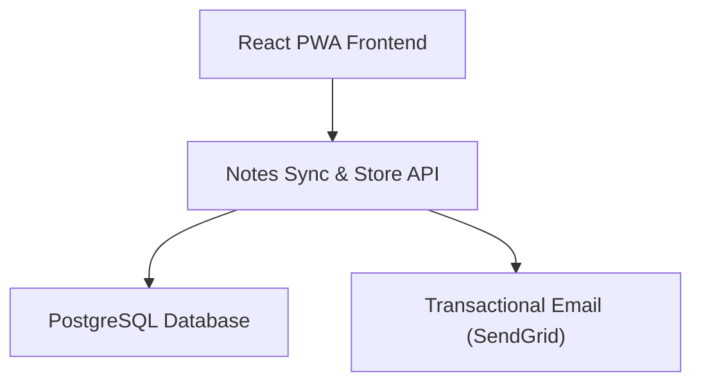
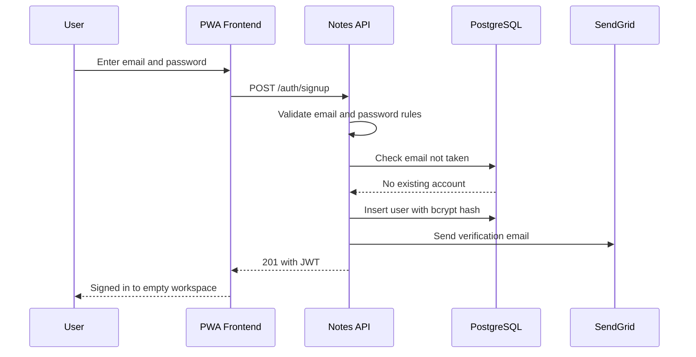
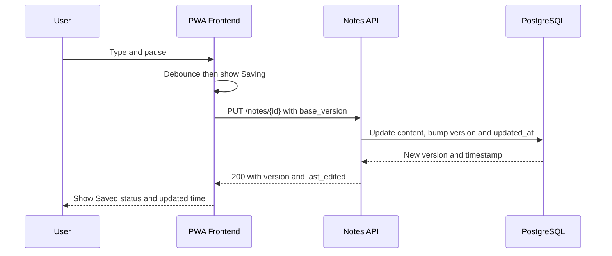
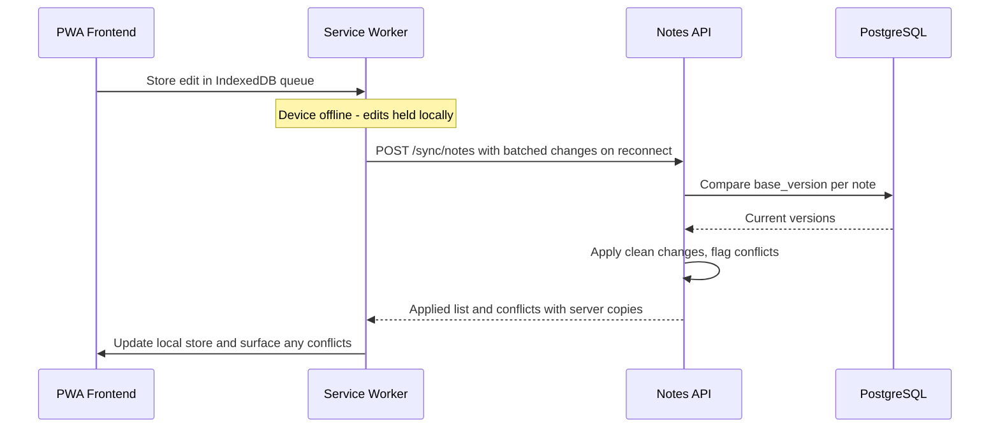
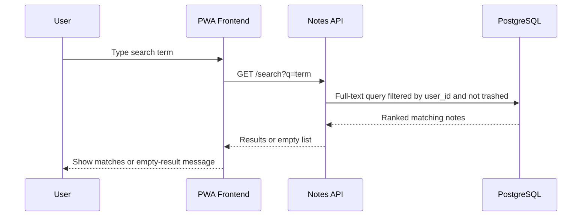
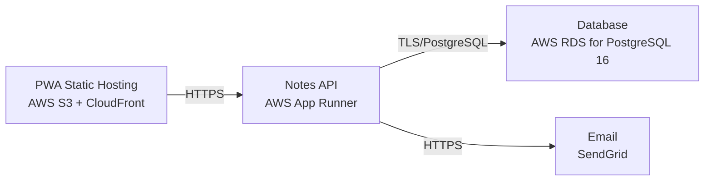

# Architecture

> Maintained by QuorQ AI SDLC. Text between `sdlc:auto` markers is regenerated; anything outside them is yours and is kept.

<!-- sdlc:auto:start narrative -->
## Overview

### ARCH-OVERVIEW · approved · source: architecture:summary

Approved v1 architecture for a free, lightweight consumer notes app: an installable React 19 PWA backed by a FastAPI sync/store API and PostgreSQL 16 on AWS.

The app lets users sign up/log in with email+password, create rich-text notes (headings, bold/italic, lists, checkboxes) with auto-save, organise notes into folders, rename/move them, search titles and content via PostgreSQL full-text search, and delete to a recoverable trash. The PWA caches notes locally (offline read/edit) and syncs batched offline changes on reconnect via background sync with version-based conflict reconciliation so no edits are lost silently. Notes are strictly private per account; endpoints are JWT-protected and passwords are bcrypt-hashed. SendGrid sends verification and password-reset emails.

- ⚠ Requirement descriptions for US-001..US-018 were not provided, so this architecture cannot be explicitly traced to specific requirement IDs beyond the known key list.

### ARCH-COMPONENT-pwa_frontend · approved · source: architecture:components:pwa_frontend

React 19 Progressive Web App is the sole client, providing the editing, organisation, search, trash, and offline experience.

Responsibilities: rich-text note editing with auto-save and a save-status indicator; notes list showing last-edited time; folder navigation; search box; trash/restore UI. It is installable and service-worker-backed, caching notes in IndexedDB for offline read/edit and queuing changes for background sync when offline.

### ARCH-COMPONENT-notes_api · approved · source: architecture:components:notes_api

FastAPI 0.115 service is the Notes Sync & Store API, owning auth, per-account privacy enforcement, CRUD, sync, search, and trash.

Responsibilities: authenticates users and enforces per-account privacy on every request; serves CRUD for notes and folders; accepts batched note changes with version-based conflict reconciliation; runs full-text search; manages trash/restore; triggers verification and password-reset emails via SendGrid.

### ARCH-COMPONENT-postgres_db · approved · source: architecture:components:postgres_db

PostgreSQL 16 is the system of record for accounts, notes, folders, and trash state, and powers search.

Stores user accounts, notes (rich-text content and metadata), folders, soft-delete/trash state and last-edited timestamps. Serves full-text search via built-in tsvector indexing. Encrypted at rest.

### ARCH-COMPONENT-email_service · approved · source: architecture:components:email_service

SendGrid delivers account-verification and password-reset transactional emails.

Used by the Notes API to reliably deliver verification emails at signup and password-reset emails on request.

### ARCH-CRITICALPATH-auth · approved · source: architecture:critical_paths:signup_login

Sign-up and login establish private, JWT-protected sessions.

New users register with a validated email and a password meeting minimum requirements; duplicate emails are refused. Returning users log in and receive a JWT. Login failures return a single non-revealing error (no account enumeration). All note endpoints require a valid token, enforcing per-account privacy.

### ARCH-CRITICALPATH-autosave · approved · source: architecture:critical_paths:edit_autosave

Editing a note debounces keystrokes and auto-saves via the API, which bumps version and timestamp.

While editing, the frontend debounces keystrokes and sends the latest content; the API persists it, bumps the note's version and last-edited time, and returns the new version so the UI can show save status.

### ARCH-CRITICALPATH-offline-sync · approved · source: architecture:critical_paths:offline_sync

Offline edits are queued locally and reconciled against the server on reconnect using version comparison.

Offline, edits are written to IndexedDB and queued. On reconnect, the service worker replays the batch; the API compares each change's base_version to the stored version and either applies it or flags a conflict, returning server copies so the client can reconcile without silent data loss.

### ARCH-CRITICALPATH-search · approved · source: architecture:critical_paths:search

Full-text search scans only the authenticated user's own non-trashed notes.

A search query runs a PostgreSQL full-text search over the user's own non-trashed notes' titles and content, returning matches scoped to the account. An empty match set yields a clear empty result.

### ARCH-DATA-MODEL · approved · source: architecture:entities

Four core entities: users, folders, notes, and password_reset_tokens.

users: id, email, password_hash, email_verified, created_at. folders: id, user_id, name, created_at. notes: id, user_id, folder_id, title, content, content_text, search_vector, version, is_trashed, trashed_at, created_at, updated_at. password_reset_tokens: id, user_id, token_hash, expires_at, used_at. The notes table carries both the version counter used for conflict reconciliation and the search_vector used for full-text search.

### ARCH-API-ENDPOINTS · approved · source: architecture:endpoints

17 REST endpoints cover auth, folders, notes CRUD, trash, search, and offline sync.

Auth: POST /auth/signup (create account, send verification email, return session token); POST /auth/login (authenticate, return JWT, non-revealing failure message); POST /auth/logout (end session); POST /auth/password-reset/request (send reset email if account exists, no enumeration); POST /auth/password-reset/confirm (set new password via reset token). Folders: GET /folders (list), POST /folders (create). Notes: GET /notes (list active notes, optional folder_id filter, with title and last-edited time); POST /notes (create empty note ready for editing); GET /notes/{id} (open owned note); PUT /notes/{id} (auto-save title/content/folder, bump version and last-edited time); POST /notes/{id}/trash (move to trash); POST /notes/{id}/restore (restore with content intact); DELETE /notes/{id} (permanently delete a trashed note). Trash: GET /trash (list trashed notes). Search: GET /search (full-text search across own titles/content). Sync: POST /sync/notes (replay batch of offline changes; apply clean changes, return conflicts with server copies).

### ARCH-DEPLOYMENT · approved · source: architecture:deployment_nodes

All-AWS deployment: static PWA on S3+CloudFront, API on App Runner, database on RDS, email via SendGrid SaaS.

PWA Static Hosting: AWS S3 + CloudFront serving the static React 19 build with service worker. Notes API: AWS App Runner running FastAPI 0.115 on Python 3.12 (Uvicorn). Database: AWS RDS for PostgreSQL 16. Email: SendGrid SaaS API (external, not AWS-hosted).

### ARCH-TECH-DECISIONS · approved · source: architecture:technology_decisions

Four stack decisions were made and documented with alternatives considered: React 19, FastAPI 0.115, PostgreSQL 16, and AWS.

Frontend: React 19 chosen over Vue 3 and Svelte to drive the state-heavy editing screen, auto-save status, live notes list/search, and the installable PWA with service-worker offline caching and background sync, backed by mature rich-text and PWA libraries. Backend: FastAPI 0.115 chosen over Express and Django REST Framework as a lightweight Python API cleanly covering sign-up, JWT-protected per-user access, and batched sync endpoints, keeping the free consumer app cheap to run and quick to extend. Database: PostgreSQL 16 chosen over MySQL and SQLite to store the relational accounts/notes/folders/trash model with last-edited timestamps and to serve search directly via built-in full-text (tsvector/GIN), avoiding a separate search engine. Cloud: AWS chosen over Google Cloud and Azure to host the API (App Runner), database (RDS PostgreSQL 16 with backups and encryption), and integrate email in one account, with reliable always-on hosting for cross-device sync and room to grow.
<!-- sdlc:auto:end narrative -->

<!-- sdlc:auto:start building-blocks -->
## Building Block View

| ID | Name | Technology | Responsibility | Depends on |
|---|---|---|---|---|
| pwa_frontend | React PWA Frontend | React 19 | Rich-text note editing with auto-save and save-status indicator, notes list with last-edited time, folders, search box, trash/restore UI, and an installable service-worker-backed PWA that caches notes in IndexedDB for offline read/edit and queues changes for background sync. | notes_api |
| notes_api | Notes Sync & Store API | FastAPI 0.115 | Authenticates users, enforces per-account privacy on every request, serves CRUD for notes and folders, accepts batched note changes with version-based conflict reconciliation, runs full-text search, manages trash/restore, and triggers verification and reset emails. | postgres_db, email_service |
| postgres_db | PostgreSQL Database | PostgreSQL 16 | Stores user accounts, notes (rich-text content and metadata), folders, soft-delete/trash state and last-edited timestamps, and serves full-text search via built-in tsvector indexing. Encrypted at rest. | — |
| email_service | Transactional Email (SendGrid) | SendGrid | Delivers account-verification and password-reset emails reliably to the inbox. | — |

<!-- sdlc:auto:end building-blocks -->

<!-- sdlc:auto:start runtime -->
## Runtime View

### Sign-up and login with private sessions

New users register with a validated email and a password meeting minimum requirements (duplicate emails refused); returning users log in and receive a JWT. Login failures return a single non-revealing error. All note endpoints require a valid token.

- **Components:** pwa_frontend, notes_api, postgres_db, email_service
- **Modules:** auth_router, security, user_repository, email_sender
- **Key functions:** signup(email, password), login(email, password), hash_password(password), verify_password(password, hash), create_access_token(user_id), send_verification_email(email, token)

### Edit note with auto-save

While editing, the frontend debounces keystrokes and sends the latest content; the API persists it, bumps the version and last-edited time, and returns the new version so the UI shows save status.

- **Components:** pwa_frontend, notes_api, postgres_db
- **Modules:** notes_router, note_repository, editor_state
- **Key functions:** autosave(note_id, title, content, base_version), update_note(note_id, user_id, payload), derive_title(content)

### Offline edit and background sync with reconciliation

Offline, edits are written to IndexedDB and queued. On reconnect the service worker replays the batch; the API compares each change's base_version to the stored version and either applies it or flags a conflict, returning server copies so the client can reconcile without silent data loss.

- **Components:** pwa_frontend, notes_api, postgres_db
- **Modules:** service_worker, sync_queue, sync_router, note_repository, conflict_resolver
- **Key functions:** queue_change(note_id, payload), replay_on_reconnect(), sync_batch(changes), reconcile(base_version, server_version, incoming)

### Full-text search across own notes

A search query runs a PostgreSQL full-text search over the user's own non-trashed notes' titles and content, returning matches scoped to the account; an empty match set yields a clear empty result.

- **Components:** pwa_frontend, notes_api, postgres_db
- **Modules:** search_router, note_repository
- **Key functions:** search_notes(user_id, query), to_tsquery(query)

<!-- sdlc:auto:end runtime -->

<!-- sdlc:auto:start deployment-view -->
## Deployment View

| Name | Service | Runtime | Scaling | Environment |
|---|---|---|---|---|
| PWA Static Hosting | AWS S3 + CloudFront | Static React 19 build with service worker | CDN edge cache | dev |
| Notes API | AWS App Runner | FastAPI 0.115 on Python 3.12 (Uvicorn) | 1 instance, auto-scale on request load | dev |
| Database | AWS RDS for PostgreSQL 16 | PostgreSQL 16 | Single instance, automated backups, encryption at rest | dev |
| Email | SendGrid | SaaS API | Managed by provider | dev |

| Source | Target | Protocol |
|---|---|---|
| PWA Static Hosting | Notes API | HTTPS |
| Notes API | Database | TLS/PostgreSQL |
| Notes API | Email | HTTPS |

<!-- sdlc:auto:end deployment-view -->

<!-- sdlc:auto:start decisions -->
## Architecture Decisions

| Layer | Choice | ADR |
|---|---|---|
| Frontend | React 19 | [ADR-0001](adr/frontend.md) |
| Backend | FastAPI 0.115 | [ADR-0002](adr/backend.md) |
| Database | PostgreSQL 16 | [ADR-0003](adr/database.md) |
| Cloud | AWS | [ADR-0004](adr/cloud.md) |
<!-- sdlc:auto:end decisions -->

<!-- sdlc:auto:start links -->
## Related Documents

- [Data Model](data-model.md)
- [API Specification](api/openapi.yaml)
- [Architecture Decision Records](adr/README.md)
<!-- sdlc:auto:end links -->
